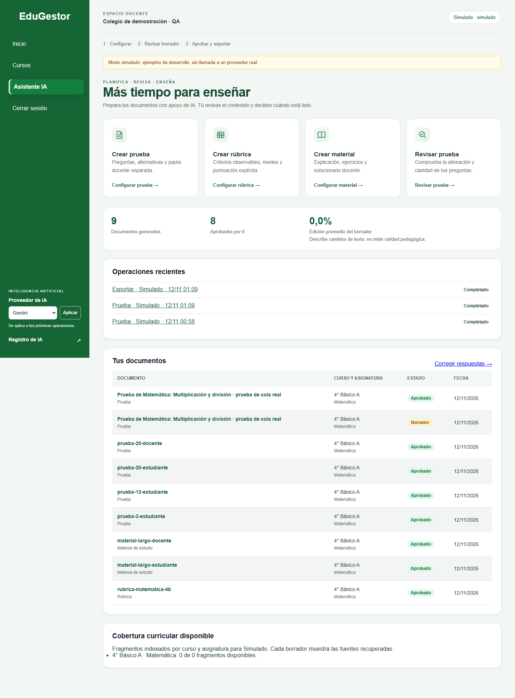
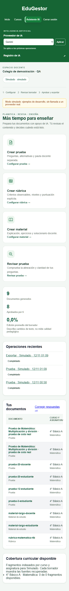
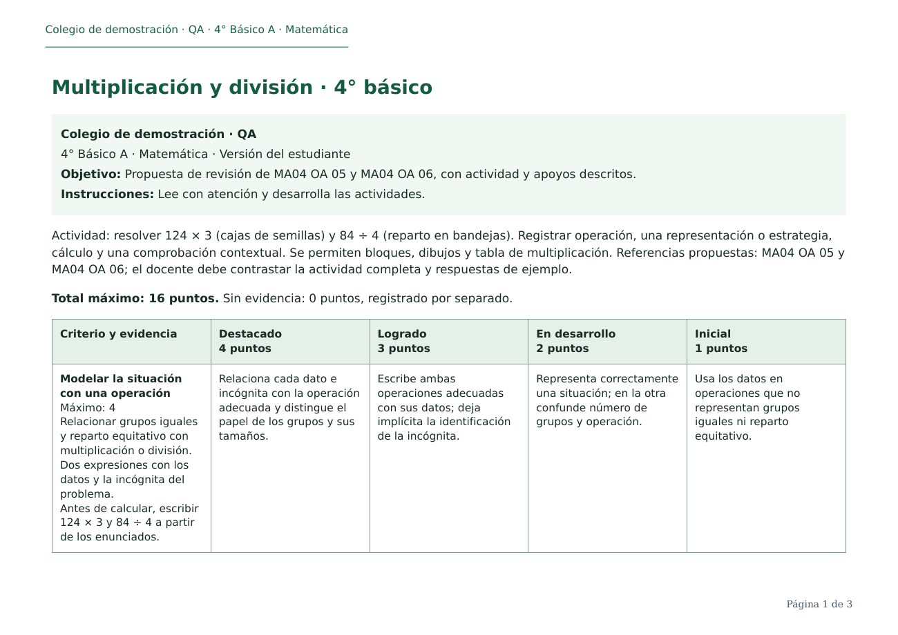

# Evidencia del asistente docente

Esta página conserva la evidencia inicial de los cinco commits de implementación. La ampliación y sus comprobaciones más recientes están en [validacion-publicacion.md](validacion-publicacion.md).

Rama iniciada desde `origin/main` en `2dfa267` y actualizada antes del push a `91ec381`, que solo incorpora la limpieza de un archivo ajeno a la aplicación. Implementación y QA ejecutadas en el checkout de seguimiento, con PostgreSQL y Redis exclusivos del proyecto Compose `edugestor-asistente-qa`, puerto `127.0.0.1:8002`. La base, archivos, credenciales y documentos de la instalación habitual no se migraron ni reemplazaron.

## Verificación local observada

| Comprobación | Evidencia |
|---|---|
| Django y PostgreSQL/pgvector | 143 pruebas correctas, 208,678 s. Incluyen documentos, notas deterministas, aislamiento, sesiones caducadas, conexión cambiada, idempotencia, trabajos interrumpidos y streaming HTTP controlado. |
| Cloudflare Worker | 4 pruebas Node correctas: POST y cuerpo conservados, cabeceras reemplazadas, ruta con doble slash, redirecciones y caída de origen. No se llamó a una cuenta Cloudflare. |
| Migraciones | Instalación desde cero hasta `0023_registroia_diagnostico_trabajoia` correcta en la base de QA. La migración agrega un modelo y diagnóstico; no transforma documentos aprobados ni vectores existentes. |
| Comprobación Django | `manage.py check`: sin incidencias; desaparece `staticfiles.W004`. |
| Navegador con Celery/Redis reales | Login, POST de generación simulada, recuperación del trabajo, borrador editable, aprobación, exportación por POST y descarga PDF autenticada correctos. Sin errores JavaScript observados. |
| Adaptación | Capturas de escritorio 1440 × 1000 y viewport móvil 390 × 844, sin desbordamiento horizontal de la página. Las tablas conservan desplazamiento propio. Es una comprobación de navegador, pendiente el dispositivo físico. |
| PDF | Siete muestras sintéticas: materiales largos estudiante/docente, pruebas de 3, 12 y 20 preguntas y rúbrica de 4° básico. Render a PNG y revisión visual; A4, cabeceras y páginas, sin localhost. La versión estudiantil excluye los campos de pauta antes de renderizar; se verificó también ausencia de marcadores reservados en el texto del PDF. |
| ARM | Manifiestos de Python, PostgreSQL/pgvector, Redis y Caddy incluyen `linux/arm64`; digest registrados en `deploy/imagenes-arm-verificadas.json`. Todavía no se ejecutaron en una VM ARM Oracle. |
| Producción | Compose valida sin resolver archivos de secretos. `check --deploy` con valores sintéticos conserva dos avisos de política HSTS (subdominios y preload), que deben decidirse para el host definitivo. |
| Estáticos y Caddy | `collectstatic`: 150 archivos copiados y 710 procesados, sin error. La imagen Caddy fijada valida su configuración con valores sintéticos; el host público se fija explícitamente en el salto a Django. |
| Ajuste final de copias | Las tres pruebas de vistas de documentos volvieron a pasar tras añadir idempotencia a la creación de copias; un reenvío conserva una sola copia. |

La captura de progreso corresponde a una respuesta simulada que atravesó un worker real; no acredita una respuesta de Gemini o Qwen. Las pruebas reales quedan a cargo del docente desde Registro de IA, según [la guía manual](pruebas-manuales-asistente.md). No se extrajeron conexiones personales ni se ejecutaron llamadas reales en esta validación.

## Interfaz observada

## Revisión de impresión y del caso de Matemática

Se inspeccionaron las dos páginas de la rúbrica aportada. La última fila continuaba casi sola en la segunda página, con fecha y localhost del navegador. El ejemplo de QA utiliza una actividad nueva y sintética: 124 × 3 y 84 ÷ 4, con criterios de modelación, representación de estrategia, cálculo e interpretación/comprobación. La escala 4–3–2–1 y el total 16 se calculan en el servidor; se separa «Sin evidencia: 0».

El ejemplo debe contrastarse con respuestas de estudiantes y con [MA04 OA 05](https://www.curriculumnacional.cl/curriculum/1o-6o-basico/matematica/4-basico/ma04-oa-05) y [MA04 OA 06](https://www.curriculumnacional.cl/curriculum/1o-6o-basico/matematica/4-basico/ma04-oa-06). Sus ámbitos numéricos se verificaron en la [página oficial de Matemática 4° básico](https://www.curriculumnacional.cl/curriculum/1o-6o-basico/matematica/4-basico). Estas referencias fueron revisadas para elaborar el caso; el PDF de ejemplo no se atribuye una recuperación RAG que no ocurrió.

[PDF de la rúbrica sintética](evidencias-asistente/rubrica-matematica-4b.pdf)

El documento admite varias páginas para mantener letra legible y filas completas. La aprobación pedagógica sigue siendo del docente; la validación estructural no acredita por sí sola calidad o alineación curricular.

## Aceptación pendiente

- Pruebas reales de Gemini y Qwen introduciendo sus claves desde la interfaz, con revisión del contenido y sus fuentes.
- Verificación en celular físico y red externa.
- Cuentas Oracle/Cloudflare/DuckDNS, elegibilidad efectiva, build y ejecución en ARM, certificado y dirección pública.
- Reinicio de la VM sin pérdida de documentos o índices y restauración de un respaldo cifrado fuera de la VM.

Publicar esta rama o abrir su PR no integra el código en `main` ni despliega una aplicación. El acceso gratuito se prepara sin prometer disponibilidad garantizada y sin activar servicios de pago.
